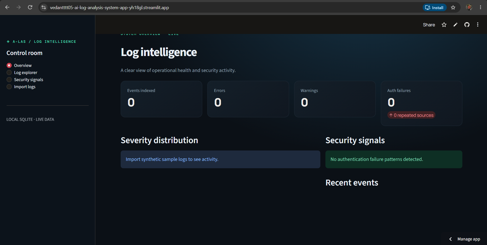
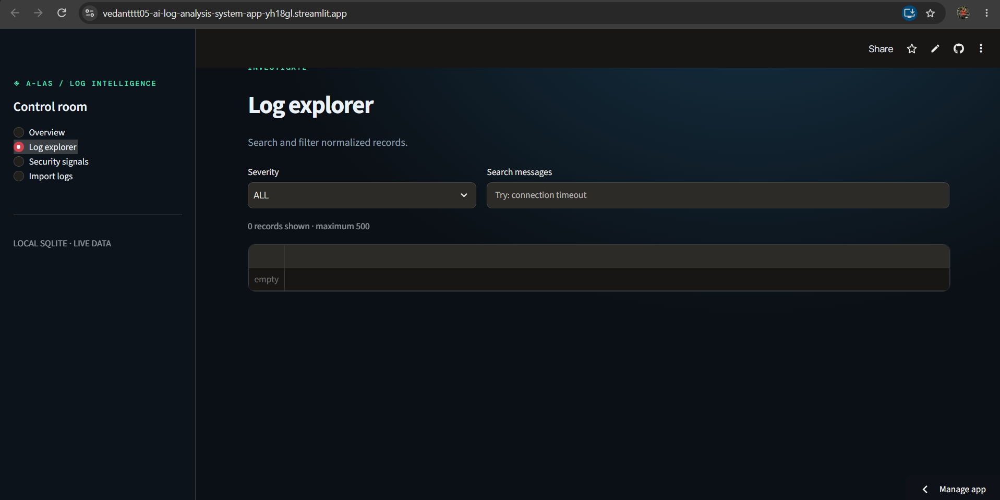
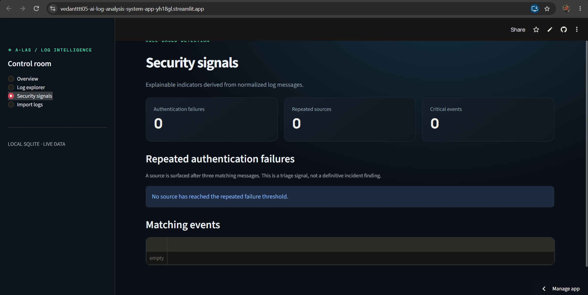
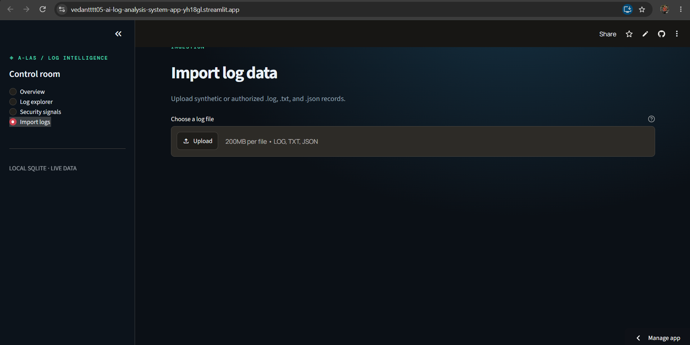

# AI Log Analysis System (A-LAS)

A Python-based application for importing, storing, exploring and analyzing application and system logs.

## Overview

A-LAS is a log intelligence platform designed to help developers and system administrators understand application activity, investigate errors and identify potentially suspicious patterns.

## Current Features

- Interactive Streamlit dashboard
- SQLite database integration using SQLAlchemy
- Log storage and retrieval
- Severity-based filtering
- Log message searching
- Duplicate log detection
- Log file import interface for `.log`, `.txt` and `.json`
- Rule-based authentication failure indicators
- Automated database tests using Pytest

*Document each feature as implemented only after verifying it works in your current version.*

## Technology Stack

- Python
- Streamlit
- SQLite
- SQLAlchemy
- Pandas
- Plotly
- Pytest

## Architecture

```text
Log Files
   |
   v
File Ingestion
   |
   v
Log Parsing and Normalization
   |
   v
SQLite Database
   |
   v
Analysis and Security Rules
   |
   v
Streamlit Dashboard
```

## Project Structure

```text
AI-Log-Analysis-System/
├── analysis/
├── config/
├── database/
├── ingestion/
├── ml/
├── parser/
├── reports/
├── screenshots/
├── tests/
├── app.py
├── init_database.py
├── database_demo.py
├── requirements.txt
└── README.md
```

## Installation

Clone the repository:

```bash
git clone https://github.com/Vedantttt05/AI-Log-Analysis-System.git
cd AI-Log-Analysis-System
```

Create a virtual environment:

```bash
python -m venv .venv
```

Activate on Windows PowerShell:

```powershell
.venv\Scripts\Activate.ps1
```

Install dependencies:

```bash
python -m pip install -r requirements.txt
```

Initialize the database:

```bash
python init_database.py
```

Run the application:

```bash
streamlit run app.py
```

## Testing

Run:

```bash
python -m pytest tests/ -v
```

## Screenshots

Application screenshots will be added to the `screenshots/` directory.

## Development Status

This project is under active development. Features and documentation will be updated as additional milestones are completed.

## Future Improvements

- Machine-learning-based anomaly detection
- AI-assisted log summaries
- PDF report generation
- Historical log analysis
- Additional security analytics

## Application Screenshots

### Dashboard


### Log Explorer


### Security Signals


### Import Logs

## Author

Vedant

GitHub: https://github.com/Vedantttt05